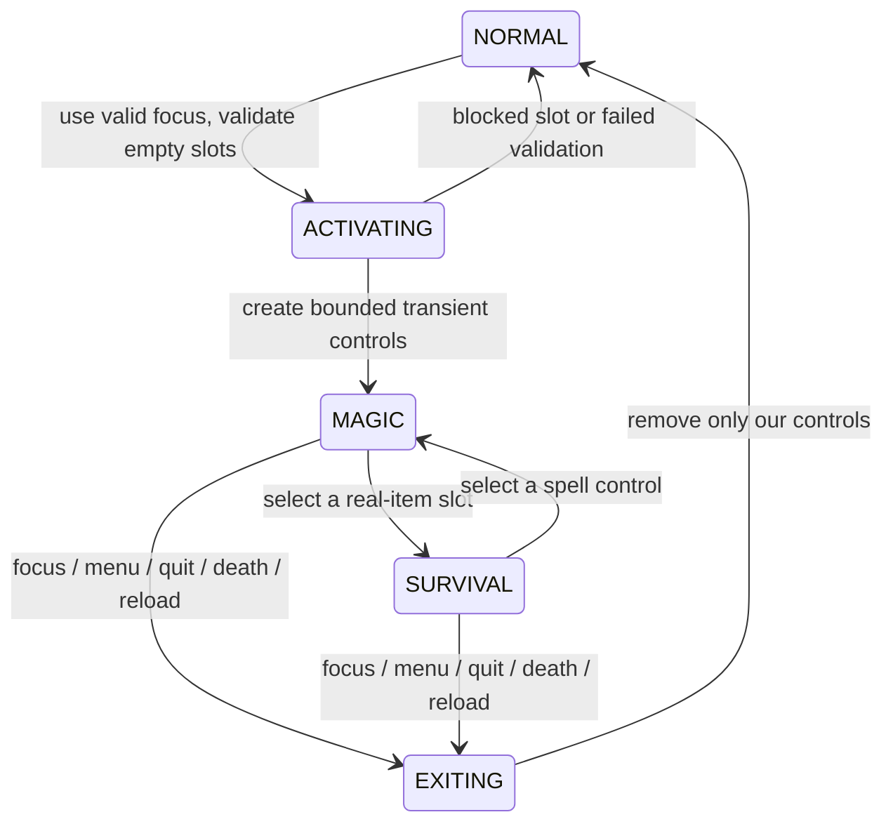

# MeerMC magic redesign: research, implementation plan and developer handoff

**Prepared: 3 October 2026, Asia/Calcutta.**

**Status: PLAN ONLY.** This document does not implement a new inventory system, replace the current GUI, publish a resource pack or change the live server. Anything labelled “proposed” is work still to do. The current implemented baseline is commit **`2cf32ea`** on CoreSuite's **`test`** branch.

This is intended to stand alone while the owner works without the assistant until around 10 October. That date is the owner's stated availability, not a scheduled automation or verified account-limit reset.

## Contents

1. [Read this first](#1-read-this-first)
2. [Current implementation and file map](#2-current-implementation-and-file-map)
3. [Research: what to learn from MagicSpells](#3-research-what-to-learn-from-magicspells)
4. [Product decisions and combat controls](#4-product-decisions-and-combat-controls)
5. [Inventory safety and crossplay](#5-inventory-safety-and-crossplay)
6. [GUI redesign specification](#6-gui-redesign-specification)
7. [Magical art and spell choreography](#7-magical-art-and-spell-choreography)
8. [Architecture, configuration and persistence](#8-architecture-configuration-and-persistence)
9. [Performance and compatibility](#9-performance-and-compatibility)
10. [Implementation phases and stop conditions](#10-implementation-phases-and-stop-conditions)
11. [Testing and release checklist](#11-testing-and-release-checklist)
12. [Local commands, backups and rollback](#12-local-commands-backups-and-rollback)
13. [Decisions, work log and next-agent prompt](#13-decisions-work-log-and-next-agent-prompt)
14. [Sources](#14-sources)

## 1. Read this first

### What the owner actually wants

- A memorable magic system with Grimoires, a wand, collectible spells, mana, exploration encounters and side quests.
- Interfaces that can be understood immediately. The owner explicitly rejected BOTH previous GUI revisions as confusing. Do not treat passing tests or nicer spacing as design approval.
- Books and wand that feel alive and magical. The latest engraved 3D designs are an improvement, but the owner still finds them stale.
- Flashy, deliberate spell animation rather than differently coloured versions of the same beam.
- Right-clicking a focus should enter a distinct magic interface/control mode. The owner proposed swapping inventory, but also raised the critical problem of not being able to eat or use emergency items.
- Good Java AND Bedrock support, including phone/controller users. Do not require keyboard-only combinations to complete important actions.
- Configurable progression and costs without dupe exploits, hidden charges, memory leaks or unbounded animation load.

### Constraints inherited from the project

1. Work on **`test`**, not `main`, unless the owner explicitly changes that instruction.
2. The **separate resource-pack repository must remain unpublished**. The live server follows its release system. A pack upload or push to its publishing branch can affect live players.
3. Never deploy experimental inventory changes to the live server. Use the isolated local copy first.
4. Do not give boss-shop swords/armour as boss drops. Gear remains a shard-shop purchase. Magic research/shards/fragments are separate progression resources.
5. Preserve existing player spells, currencies, config edits and pending-purchase records.
6. Preserve normal damage/protection events, boss arena restrictions, friendly-fire rules and vanilla item use.
7. Do not solve visual problems by increasing particle counts indefinitely.
8. No promises of “zero bugs”, perfect Bedrock parity or low CPU until measured on actual clients and the production-like plugin stack.

### Recommended scope

First ship a small, excellent **combat-control and loadout experience** with the existing eight spells. Then improve art and choreography in a controlled sequence. Do not add twenty spells, a new database system and an inventory replacement engine in the same change.

## 2. Current implementation and file map

Repository root:

```text
C:\Users\rutwi\OneDrive - MSFT\Desktop\coresuit
```

### Restore points

| Checkpoint | Meaning |
|---|---|
| `e2cc0b5` / tag `backup/pre-grimoire-2026-10-02` | Before magic implementation |
| `0739fcd` | Before the expanded contracts/progression phase |
| `1925a57` | Expanded progression, trades, contracts and local test release |
| `2cf32ea` | Current engraved art, menu revision and particle choreography |
| Pack local commit `610f7b1` | Current pack source on `codex/grimoire-pack-local-test`; not pushed |

Verify with `git status` and `git log` before editing; these values describe the handoff baseline, not future changes.

### Implemented, but not all player-accepted

- Eight spells, persistent spell tiers, prepared loadout, two starting slots/up to five, mana and cooldowns.
- Single-use sealed tomes; duplicate research/credits; page and wand binding; signature inscriptions.
- Eight scholar types, lessons, shared visit stock, material/currency/shard/custom-fish payments.
- Fish-bag payments use eligible unlocked pages after inventory fish.
- Eight contracts with objectives, repeat cooldowns and rewards; original introduction chapters remain.
- Atomic database reward receipts; optimistic profile revisions; pending purchase journals for external payments.
- Java custom models and animated textures; Bedrock static matching icons/audio mapping.
- Particle-only spell presentation using one engine loop, plus capped cosmetic echoes.
- Optional PvP zones disabled by default. Normal Bukkit damage cancellation still matters.

### Current controls — these will change only after the prototype passes

Right-click casts; sneak-left-click cycles; sneak-right-click opens the loadout. Commands `/magic cast` and `/magic next` exist. A quiet-gap input filter tries to distinguish holding use from clicking; a book does not provide a universally reliable release signal. Do not label this an exact physical-button detector.

### Current source map

All Java paths below begin with `src/main/java/net/rocky/coresuite/`.

| File | Responsibility / what to do with it |
|---|---|
| `module/grimoire/GrimoireModule.java` | Large coordinator: commands, input, menus, purchase callbacks and player lifecycle. Split carefully; do not rewrite everything at once. |
| `module/grimoire/MagicProfile.java` | Main-thread account state and serialized payload: spells, tiers, loadout, mana, cooldowns, contracts, shard balances and pending costs. |
| `module/grimoire/MagicStore.java` | SQL operations, revisions, stock reservations, tome redemption and reward receipts. Reuse. |
| `module/grimoire/MagicProgression.java` | Costs, upgrades, contract and inscription helpers. |
| `module/grimoire/MagicFishPayment.java` | Plans fish removal without mutating inventory during validation. |
| `module/grimoire/SpellSpec.java` | Stable spell IDs and bounded numeric gameplay configuration. |
| `module/grimoire/SpellEngine.java` | Gameplay projectiles, targets, harvesting, healing and short teleports. |
| `module/grimoire/SpellVisuals.java` | Current cosmetic circles/trails/echoes and point budget. Extend or extract; keep gameplay independent. |
| `module/grimoire/CastInputGate.java` | Held-input debounce. Test Java and Bedrock behaviour rather than assuming parity. |
| `module/grimoire/MagicZone.java` | Fail-closed configured PvP region checks. |
| `module/worldencounters/WorldEncountersModule.java` | Scholar visits, lesson costs and enchanter placement. |
| `module/sidequests/SideQuestsModule.java` | Quest command integration. |
| `module/worldbosses/rewards/BossLootManager.java` | Bridge from eligible boss participation to magic receipts. |
| `common/integration/MagicMappingUpdater.java` | Merges missing Geyser mapping entries and backs up existing files. |

Configuration: `src/main/resources/modules/{grimoire,world-encounters,side-quests}.yml`. Module switches in the main config remain opt-in for normal installations; the local gameplay copy enables them.

Art/build sources:

- `pack-publisher/scripts/build_magic_models.py`: generates mappings, baseline models and then applies art finishing.
- `pack-publisher/scripts/magic_art_direction.py`: current authored cover/metal/page textures and wand finishing, using Pillow.
- `resourcepack/`: CoreSuite's source asset tree.
- `meermc-resourcepack/pack/`: separate publishing repository's LOCAL asset tree.
- `deployment/geyser/custom_mappings/coresuite_magic.json`: deployment mapping; embedded copy under `src/main/resources/integrations/`.
- `docs/grimoire/art/*.svg`: older icon drafts; these are NOT the current complete engraved-cover source.

Current model IDs: book `71001` Grimoire, `71002` generic tome, `71010–71017` eight tomes; blaze rod `71030` wand. Preserve these IDs. New visual states need an allocated, collision-checked range, not reuse of someone else's custom items.

### Current data model

SQL tables: `coresuite_magic_profiles`, `coresuite_magic_research`, `coresuite_magic_stock`, `coresuite_magic_shard_rewards`, `coresuite_magic_tomes`. Profiles use YAML payloads and revisions. There is no new hotbar-session table yet.

The purchase journal captures cash, research, stock, materials, shards, fish and duplicate credits before external debits. SQL, Vault and inventory files cannot share one atomic transaction. An uncertain purchase intentionally requires review through `/magicadmin pending` and `/magicadmin reconcile`; never turn reconnect into automatic “charge again”.

### What verification currently proves

Latest baseline: 216 JUnit tests, 238 existing regression checks, 10 Python checks; Paper 26.2 startup/integration/reload/shutdown probe passed. Earlier `1925a57` runtime was also checked on Paper 1.21; latest source compiles against that API.

These results do **not** prove that the current GUI is easy, animated textures look right on every client, Bedrock controls work comfortably, MySQL recovery is tested, or the server survives a crowded battle without extra cost. Those remain acceptance work.

### Existing issues to investigate before feature work

- Current menu actions can open/close inventories directly from `InventoryClickEvent`. Paper documents restrictions on this; defer transitions to the next server tick and revalidate player/menu state. [S7]
- The menu visually separates things but still asks players to infer too much: spell preparation versus selection, research versus shards, and where to find a lesson.
- A single long tooltip is not a good phone interface. Raw material lists can still wrap badly.
- The current global cosmetic point cap is not a network-byte cap or a per-viewer cap. It also does not include every older direct particle call in the engine.
- Review bounded objective queues on immediate disconnect during an outstanding save. Saved counters persist, but that alone does not prove every queued event is durable.
- Review offhand focus interaction while the main hand holds food/shield/other usable items on both editions. Do not infer correctness from comments.

## 3. Research: what to learn from MagicSpells

Reference: `https://github.com/TheComputerGeek2/MagicSpells`.

Source snapshot inspected: **`c5f1fdada6fc0db661c1d699b221a288686fd4a3`** on main. Research included the repository README, effect/projectile/composition wiki pages, and selected source in `MultiSpell`, `ParticleProjectileSpell`, `SpellEffect`, `SpellCastEvent` and `CastItem`. This was a targeted design review, not a security audit or full repository review.

| Observed pattern | Our application | What we are NOT assuming |
|---|---|---|
| Effects attached to caster/projectile/target/end positions, with delays and intervals [S2] | Give every spell separate anticipation, release, travel, impact and decay stages. | More simultaneous particles automatically make better art. |
| MultiSpell composes actions and delays [S3] | A small typed sequence format for existing spell behaviours. | We need a general scripting language or one scheduler task per action. |
| Particle projectile settings distinguish travel, collisions and end behaviour [S4] | Separate hit detection from visuals; configure speed/lifetime and explicit impact actions. | The reference's settings are drop-in CoreSuite YAML. |
| Cancellable cast event exposes casting state and costs [S5] | One cast pipeline with explicit failure reasons and cancellation before irreversible effects. | Events replace WorldGuard or boss protection checks. |
| Cast-item matching considers configurable item properties [S6] | Treat names/models as presentation; retain our own PDC identity and entitlement checks. | Matching a pretty item name proves ownership. |

**Recommendation:** keep CoreSuite's progression, storage and integrations; borrow architectural ideas, not an entire dependency. Evaluate an external effect library only if a prototype shows meaningful benefit over the existing bounded renderer.

MagicSpells' repository declares GPL-3.0 and includes licensing guidance. Keep our implementation original; if someone later copies code or links the API, review the repository's LICENSE/NOTICE and distribution requirements first. This is a project dependency decision, not a claim that reading ideas changes CoreSuite's license. [S1]

## 4. Product decisions and combat controls

### Recommendation: a magic combat hotbar with survival slots

The player's idea is good in purpose: entering magic should make available spells obvious and quick to select. Replacing all 36 inventory slots is not required to achieve that purpose.

**First implementation: reserve empty hotbar slots only. Do not move or escrow real items.** This is a recommendation awaiting gameplay acceptance, not a decision already approved by the owner.

Proposed default layout (screen labels are 1–9; Bukkit indexes are 0–8):

```text
MAGIC ACTIVE
[Spell 1][Spell 2][Spell 3][Spell 4][Spell 5][Sword][Food][Potion][Focus]
   temporary spell controls, when unlocked       real items stay here

NORMAL
[ empty ][ empty ][ empty ][ empty ][ empty ][Sword][Food][Potion][Focus]
```

- Starter with two prepared slots reserves only slots 1–2. Do not fill three extra slots with useless locked tokens. Expanded loadouts reserve only their used/configured positions.
- The four remaining physical hotbar positions are real inventory items, not copied items or virtual shortcuts. Their consumption/durability is handled normally by Minecraft.
- Armour and offhand never get replaced. A totem already in the offhand continues behaving normally.
- Focus in slot 9 is a suggested setup, not an unannounced hardcoded requirement. Validate any custom layout for unique, in-range slots and at least three real-item positions plus a reachable focus/exit.
- If a required spell position contains a real item, activation fails with a precise message: “Move the item from hotbar slot 2 to use this loadout.” Never silently shuffle or overwrite it.
- Provide a one-time setup screen and a non-hotbar fallback for players who dislike reserving space.

### Exact interaction proposal

| Action | Result |
|---|---|
| Use Grimoire/wand once | Enter magic mode; do not cast on the activation event. Show a short seal animation and selected spell. |
| Select a spell slot | Select it and show name/mana/cooldown. Selection alone NEVER casts. |
| Use selected spell control | Request one cast through the shared input gate. |
| Select sword, food or potion slot | Pause magic input immediately; vanilla actions work on the real stack. Magic controls can stay visible. |
| Select a spell slot again | Resume spell control without resetting cooldown/mana. |
| Use focus while mode is active | Exit mode and remove our temporary controls. Do not cast. |
| `/magic exit` | Always provide an emergency exit, including when mana is empty or a purchase is pending. |
| `/grimoire` | Open loadout setup outside the battle control flow. Entering a menu exits the transient hotbar mode first. |
| Death, quit, world change, module disable | Clean transient controls; persistent spell ownership is unaffected. |

Activation must latch the input until a quiet gap/validated release so a held button does not activate and immediately cast. Do not claim exact hold detection where the protocol does not provide it. A right-click on a chest, trader or interactive block should normally keep the block interaction; initially require focus use in air for activation and explain this in setup.

### Combat example

1. Player enters mode and casts Frost Lance from slot 2.
2. Boss hits them. They select slot 7 and eat their actual golden apple immediately.
3. The offhand totem remains equipped throughout; magic input is paused while holding food.
4. Player selects slot 2 again. Its original cooldown remains; no reset from switching modes.
5. Player uses slot 9 to exit and open their ordinary inventory.

No health-threshold auto-swap by default: unexpectedly changing the held item while the player drinks can be worse than leaving control with them. A low-health hint can be added later, throttled and configurable.

### Why not a complete replacement first?

| Design | Benefit | Cost / decision |
|---|---|---|
| Empty-slot combat palette | Clear spells, real food and equipment, no displaced items | Requires a little hotbar preparation. Recommended prototype. |
| Existing focus + selected spell | Leaves all hotbar space free | Less visible selection; retain as fallback. |
| Packet-only fake hotbar | Visually replaces slots without moving server items | Client/server disagreement, Geyser translation and wrong-item interactions need substantial version-specific testing. Not first release. |
| Real full inventory swap + escrow | Largest dedicated magic UI | Crash recovery, deaths, grave plugins, world inventories and other inventory writers become critical. Defer. |

If the owner rejects reserved slots after testing, pause that feature and revisit the full-swap design in section 5. Do not force a disliked interaction because it is easier to implement.

## 5. Inventory safety and crossplay

### Empty-slot palette invariants

An invariant is a rule that must always remain true:

1. Activating magic never changes a real item's amount, metadata, location or durability.
2. Temporary spell controls cannot be traded, dropped, stored, crafted, sold, consumed, repaired or included in grave loot.
3. A control only works for the owning online player, current session and current prepared spell.
4. Exit deletes only controls belonging to this system. It never clears a slot merely because we expected a control there.
5. If another plugin replaces a control with a real item, preserve the real item and end the session.
6. No inventory-wide snapshot is restored for this design; doing so would resurrect consumed food or broken equipment.

### Session design

Create `MagicSession` containing player UUID, random session UUID, selected spell, reserved slot numbers, state, start time and config revision. Keep it on the main thread. Do not retain `Player` objects in long-lived maps.

Control PDC should identify an unambiguous control kind, owner UUID, session UUID and spell ID. Names and model IDs are not sufficient. It must NOT have the existing `tome:` kind or a redemption seal. Commands/purchases may never create or accept it as a real tome.

Recommended states:



All events go through one controller; do not let separate listeners disagree about whether the player is casting or eating. Exiting should be idempotent: running cleanup twice has the same result as running it once.

### Inventory/event checklist

- Handle normal clicks, shift-click, number-key swaps, offhand swap, double-click collect, drag, drop, creative actions and pick-block attempts.
- Handle hopper/container movement if a control ever escapes. Sweep stale controls on join/load and purge identified tokens on relevant inventory interactions.
- On death remove controls from drops; preserve all genuine drops and the server's keepInventory behaviour. Test event ordering with AxGraves and InventoryRollbackPlus.
- Other plugins can directly edit inventories without normal click events. Revalidate control identity on cast and slot change; avoid fighting other plugins with a forced rewrite every tick.
- Pickup into empty, non-control slots can remain normal. Do not cancel all pickups merely because magic is active.
- Food/potions must be real stacks in unreserved slots. Let native consumption decrement them; don't manually consume copies.
- Player inventory opening via the inventory key is not safely covered by assuming one `InventoryOpenEvent` fires on all clients. Handle the resulting inventory transactions explicitly; cancel a control manipulation, exit cleanly and explain/retry when needed.
- For menu transitions initiated by inventory clicks, cancel the click and schedule the open/close on the next main-thread tick. Revalidate owner, online status and current menu/session revision before running the action. [S7]
- Process inventory changes on the main thread. Database operations use immutable snapshots on the existing bounded database executor.

### If full swapping is later approved

Do not implement “save inventory in a HashMap, set contents, restore on quit”. That loses inventory on crash and conflicts with death/consumption.

Minimum design before any release:

1. Define ownership of every slot: swapped spell positions versus untouched survival/armour/offhand positions.
2. Persist an intent containing a session ID, complete serialized displaced stacks, exact slot indexes, server/config version and checksum BEFORE removing real stacks. Include custom PDC, damage, enchants and nested contents.
3. Apply inventory changes on the main thread; persist player data and transition the journal. Treat a crash between these independent saves as ambiguous, not automatically resolved.
4. On recovery compare actual item/control fingerprints and journal phase. Do not blindly replay a saved inventory; that can duplicate items already dropped or transferred.
5. Reconcile restore exactly once using a persisted state/version. When ambiguous, isolate the session for admin recovery without discarding real items or letting it keep casting.
6. Never restore a full snapshot over slots holding actual consumed food/potions or damaged armour.
7. Integrate death/graves, keepInventory, Multiverse-Inventories, item-return mailboxes, server restart, login authentication and plugin disable.
8. Provide admin inspect/export/resolve commands and a written recovery procedure before making the feature usable by players.

There is no simple transaction spanning SQL, Minecraft player files and arbitrary inventory plugins. This is why the first design avoids displacing real items.

### Java and Bedrock support

Use Floodgate's API to detect connected Bedrock players and offer a suitable management interface. Its form API is useful for setup, but a modal form is not a combat HUD. [S8]

| Java | Bedrock |
|---|---|
| Number keys or scroll to select a spell | Tap/controller-select the same hotbar slot |
| Right-click uses a focus/control | Client use/interact action; verify touch “use” availability for the chosen custom item |
| Optional keyboard shortcuts | Every required action has a visible slot or button alternative |
| Inventory-based setup | Optional Floodgate simple forms with explicit Prepare/Replace/Back actions |

Geyser requires separate Bedrock mappings and assets; it does not automatically convert the Java pack. Dynamic item behaviour also differs between editions. Prototype the actual control item's base material and use behaviour before making art for it. [S9]

Do not depend on offhand swap, sneak-punch timing, dropping the item, or scrolling while sneaking as the only way to use magic. Java/Floodgate-linked identity must use authenticated UUIDs, not name prefixes.

Prototype acceptance: one Java client and a real Bedrock touch client can activate, select, cast, eat, drink, trigger a totem, exit, reconnect and recover with identical costs. Until a Bedrock device has done this, mark the feature experimental and retain the old control mode.

## 6. GUI redesign specification

### Design goal

The first screen answers just two questions: **What do I have equipped? How do I change it?** Upgrades, currencies and lore are secondary destinations. Do not put a shop, a codex, a controls guide and a loadout editor in one chest full of unrelated icons.

### Home: My Grimoire

Suggested 45-slot Java layout (zero-based inventory indexes in parentheses):

```text
Row 1:                     My Grimoire / mana
Row 2:     [Page 1] [Page 2] [Page 3] [Page 4] [Page 5]
Row 3:       short status beneath each page; empty/locked are distinct
Row 4:       [Spell collection]   [Quests]   [Enchanter]
Row 5: [Back/Close]          [Controls]          [Effects settings]
```

Implementation indexes: page buttons `11,12,13,14,15`; collection `29`, quests `31`, enchanter `33`; close `36`, controls `40`, effects `44`. Header `4`. Each button has one click action; status panes do not perform actions.

- Click a prepared page to replace its spell. Clicking should NOT silently unequip it.
- The picker shows learned spells first. Selecting one sets that specific page and returns home.
- An explicit “Empty this page” action exists in the picker; never overload right-click/shift-click.
- A locked page reads “Unlock page 3 at the Enchanter” and opens that exact purchase detail.
- Stable Back and Close positions everywhere. Every page title names the task, not just “Astral”.
- Preserve page order and selected spell identity; replacing page 4 must not reset selection to page 1 unnecessarily.
- Reopening an entire chest after every cosmetic selection can reset the cursor on some clients. Update the existing inventory for a same-screen change where safe, or schedule one transition only. Do not run a constant reopen loop.

### Spell collection

Two categories are enough initially: Learned and Discoverable. Eight spells do not need a search engine and seven tabs.

Each item: spell name, role, learned tier, mana and cooldown, one plain-language description, one action (“View spell”). No raw maps, long cost paragraphs or misleading “Click to prepare” on locked entries.

Spell detail: one visual preview item, short effect description, current values, **Prepare in page…** primary action, **Upgrade** secondary action, **Where to learn** for locked spells. Upgrade opens a separate comparison and confirmation screen.

### Purchases and quests

- Cost rows show **Have / Need**, not only the price. Research, cash, shards and duplicate credits are distinct labelled rows.
- Disable Confirm when missing requirements and name the missing requirement.
- Validate the quote again on commit; a cached GUI is never authority for prices or stock.
- Hide purchases unrelated to the nearby NPC. The Enchanter is upgrades/pages/wand; a scholar is lesson and matching contract. General resources belong in a small profile panel, not the middle of every purchase.
- Quests show one active task prominently, with per-objective counters and the exact reward. Separate “Available near this scholar” from already accepted quests.
- No chat flood for routine navigation. One quiet click sound, one success sound and a concise failure message are sufficient.
- Essentials, boss messages and the mana bar can compete for action-bar space. Define priority: critical server/boss warning > immediate cast failure > selected spell/mana > idle decoration. Avoid continuously overwriting another module's warning.

### Visual interface rules

Use custom spell icons where they clarify meaning, not identical enchanted books everywhere. Keep two consistent accents and one warning colour. Decorative panes must not resemble buttons. Text must remain understandable without the resource pack and without colour alone.

Java and Bedrock need the same decisions, not pixel-identical menus. Bedrock forms should show the selected spell and direct buttons instead of relying on hover lore. A generic inventory fallback must still work if Floodgate is absent or unavailable.

### Usability acceptance

Give a player no verbal help. Ask them to equip Tidal Arrow in page 2, find its next upgrade cost, cancel that purchase, eat during combat and leave magic mode. Target: each task understood in under 30 seconds with no accidental purchase. Record failures and simplify the screen before adding more decoration.

## 7. Magical art and spell choreography

### What is currently missing

The current covers mostly share a rectangular silhouette. Animated highlights and particles help, but “alive” also needs posture, timing, contrast and feedback. The next pass should change those, not merely add another ring to every spell.

### Art pipeline

1. Pick a consistent language: ancient celestial instruments, parchment, brass, elemental light. Preserve the existing colour identities but add different silhouettes/details.
2. Make editable Blockbench/native-model sources or equivalent documented source assets. Keep generators reproducible; do not hand-edit a generated file that the next script run overwrites.
3. Build **closed**, **awakened** and **casting** focus states as separate compatible model variants. New states need new IDs/mappings, while old inventory items keep their identity.
4. Grimoire awakened state: slightly open covers, layered pages, a suspended seal above the book. Casting state briefly flares the seal; no giant model over the crosshair.
5. Wand: darker grip, legible silhouette, crystal suspension and a short cast-state light pulse. The current rotating texture alone does not make the geometry move.
6. Ordinary Java item-model animation cannot be assumed to animate arbitrary bones. Prototype model-state swaps; use temporary display effects only where measured and necessary. Do not promise a fully animated held rig on vanilla clients without proving the method.
7. Bedrock: matching icon plus separately authored attachable/animation prototype if the exact Geyser mapping supports it. Keep static fallback until hand positions, touch use and controller use pass.
8. Inspect main/offhand, first/third person, GUI, ground and item frames, plus rain/day/night. Record client version, GUI scale, FOV and pack version with screenshots.

Do not rename the same model “premium” and call it done. Acceptance is the owner approving in-game clips of idle, cast and recovery, and a new player understanding the controls.

### Choreography storyboard — proposed, balance stays separate

| Spell | Anticipation / release | Flight / active | Impact / ending |
|---|---|---|---|
| Mana Dart | Small focus spark, crisp chime | Short needle with a sparse arcane ribbon | Compact star fracture; quick decay |
| Ember Lance | Compressed ember in a triangular seal | Spear-shaped hot core and trailing embers | Expanding flare, then smoke after the damage event; no actual fire blocks |
| Tidal Arrow | Two droplets merge into a crest | Braided current with a readable central projectile | Flattened splash fan, then falling droplets |
| Frost Lance | Six-point crystal forms | Long narrow shard silhouette with short side fragments | Radial ice fractures that fade, without placing ice blocks |
| Zoltraak | Clear focusing seal before release | Thin bright core with segmented outer distortion | Piercing target flash; different from an explosion |
| Dimension Step | Brief vertical tear at origin | Safe teleport only; short residual silhouette/particles | Matching destination tear collapses |
| Hearth | A seal unfolds from the ground | Stable low boundary, slow upward motes, sparse healing pulses | Ring retracts; remaining duration is readable |
| Harvester | A low green wave | Short branch-like traces connecting valid ripe crops | Each successfully harvested crop gives a leaf-like flourish |

Start with visual anticipation that does not add gameplay delay. If introducing a real windup later, specify interruption, mana reservation/refund and cooldown semantics explicitly; do not accidentally nerf every spell by delaying it.

### Audio and presentation constraints

- Distinct release/impact cues; small variation in pitch, not unlimited overlapping sounds.
- Preview audio in context of boss BGM and footsteps. Positional attenuation and a per-player sound cooldown matter.
- Avoid screen-filling flashes, camera shake, forced camera movement and visual clutter over boss telegraphs.
- Offer Reduced / Standard / Showcase effects presets. Cosmetic quality cannot change damage, mana, range, cooldown or targeting.
- Showcase is for private recording, not the default for a crowded server.
- Keep short gameplay tells visible for opponents; decorative particles may be culled first.

## 8. Architecture, configuration and persistence

### Proposed extraction boundaries

These class names are design suggestions, not existing APIs:

| Component | Responsibility |
|---|---|
| `MagicInputRouter` | Turns Java/Bedrock interactions into Activate, Select, Cast, Exit and OpenMenu requests. |
| `MagicSessionController` | Owns transient hotbar state and cleanup; never handles permanent purchases. |
| `MagicControlItems` | Creates/verifies non-transferable controls and stale-token removal. |
| `MagicMenuController` | Next-tick transitions, current view/session ID, screen navigation and single-click rules. |
| `MagicViewModel` | Plain data for a screen; rendered by Java inventory or optional Bedrock form adapter. |
| `MagicCastService` | Single validation/reservation/commit pipeline shared by every control method. |
| `SpellTimeline` | Bounded typed timed actions; cancels cleanly when the session/caster becomes invalid. |
| `MagicEffectRenderer` | Per-viewer quality, nearby recipients, animation lifetime and packet/point budget. |
| Existing store/profile/progression | Remain the authority for permanent unlocks, costs and receipts. |

Extract one responsibility at a time with behaviour-preserving tests. Avoid a wholesale replacement of `GrimoireModule` while changing inventory behaviour.

### Cast pipeline

```text
Input -> identify owner/session/hand -> debounce -> validate profile & prepared spell
      -> validate cooldown/mana/arena/target/capacity -> reserve cost
      -> start gameplay effect once -> record cooldown/progression
      -> publish cosmetic timeline -> release transient work on completion
```

Define failure semantics in code: rejected before reservation costs nothing; engine failure after reservation restores the reservation exactly once; an effect that successfully launches but misses is a real cast. Cosmetic renderer failure must never trigger a second damage event or a free spell.

Recheck permissions/protection at impact, not only at cast. A target may move into a claim or change worlds. Preserve the existing rule that cancelled damage must not apply fire, push or slowing afterward. PvP remains opt-in.

### Proposed configuration — NOT understood by the current JAR

Do not paste these keys into production expecting them to work. Implement validation and migration first.

```yaml
magic-interface:
  mode: reserved-hotbar       # reserved-hotbar | classic
  activation: focus-use
  spell-slots: [1, 2, 3, 4, 5]  # user-facing 1-based hotbar positions
  reserve-only-prepared: true
  occupied-slot-policy: deny  # no automatic displacement
  survival-slots: [6, 7, 8]
  focus-slot: 9
  exit-command: true
  bedrock-management: forms   # forms | inventory; fallback required
effects:
  preset: standard
  viewer-radius: 24
  per-viewer-points-per-tick: 100
  global-points-per-tick: 700
  max-transient-effects: 64
  idle-focus-effects: false
  respect-reduced-effects: true
```

Values are starting budgets, not measured safe limits. Validate unique slots, valid ranges, finite numbers, known spell/action IDs, maximum durations and particle compatibility. Parse once on load/reload into immutable settings, not repeatedly inside each particle loop.

Example timeline concept, also not current configuration:

```yaml
presentation:
  ember-lance:
    on-release:
      - {effect: seal, duration-ticks: 6, size: 0.6}
      - {effect: sound, cue: ember-release}
    on-travel:
      - {effect: ember-ribbon, interval-ticks: 2}
    on-hit:
      - {effect: flare, duration-ticks: 10, size: 1.2}
```

Use an allowlist of effect types, no arbitrary commands or expression execution. Guard recursion and cap timeline length if composition is later added. A bad visual config should disable that visual and log the exact path, not disable combat or silently spend mana.

### Persistence and migration rules

- Transient mode should start OFF after login; learned spells and prepared page order persist.
- Reserve-slot mode needs no saved original item inventory. Stale identified controls are cleaned, not restored from a snapshot.
- Add settings/defaults without overwriting existing server tuning. Back up changed YAML; bump explicit schema versions for renamed fields and make each migration safe to run twice.
- Preserve spell IDs even when display names change. Do not lose `fireball` ownership because its visible name is Ember Lance.
- Keep the current purchase journal and revision checks. Do not let a GUI refactor bypass them.
- Add persistence tests for old payloads missing new fields; empty/duplicate/unknown prepared IDs; selected spell removed; pending purchase on reconnect.
- Profile snapshots passed to async storage must not contain live Bukkit inventories/entities or mutable collections being edited on another thread.
- Test SQLite and MySQL separately before claiming both. Keep indexes bounded and inspect query plans for receipt collection when data grows.

## 9. Performance and compatibility

### Performance work that matters

1. Cache parsed effect settings and reusable geometry samples at load time.
2. One managed tick loop for timelines; no repeating task per rune/particle/player.
3. Use a fair budget across active casters. The first player in a list must not consume every frame's allowance.
4. Select nearby viewers, cache short-lived recipient sets, and use lower detail at distance. A world particle call multiplied across players can be more expensive than its point count suggests.
5. Budget total points AND deliveries: 100 points sent to 20 viewers means 2,000 deliveries. Include old direct particle calls in diagnostics.
6. Remove offline/wrong-world/unloaded-chunk effects promptly; do not load chunks for decoration.
7. Pool/reuse immutable ring samples rather than allocating many vectors for every point; optimize only after measurement shows a meaningful hot spot.
8. Update mana HUD only when visible and at a modest frequency (e.g. 4 Hz), not every tick for every online player. Cache unchanged text.
9. Bound maps/queues and clear them on quit/disable. Track counts before/after repeated sessions instead of claiming “no leaks” from a code glance.
10. Degrade decoration under load; never reduce hit detection correctness or extend cooldowns silently to save rendering work.

Proposed profiling protocol: record idle baseline, then 1/4/10 simultaneous casters for ten minutes, plus repeated activation/deactivation. Capture MSPT, TPS, heap after comparable GC points, task/entity/effect counts and client FPS. On the 16 GB laptop start with 1–4 clients/users, not an unrealistic synthetic maximum. Treat a target such as under 1–2 ms additional average tick time at four casters as a goal to measure, not an existing guarantee.

### Integration risks to test

| Integration | Required behaviour |
|---|---|
| WorldGuard / GriefPrevention | Cancelled actions stay cancelled, including secondary effects. |
| WorldBosses | No teleport escape through arena rules, no input lock that stops food/totems, no animation hiding attack tells. |
| Vulcan | No fake movement/rubberband stun; verify casts/hotbar changes do not trigger packet or inventory checks. |
| Geyser / Floodgate | Touch/controller use, static custom item registration, forms and identity handling. |
| AxGraves / InventoryRollbackPlus | No transient controls in saved loot; no duplicate restored real items. |
| Multiverse-Inventories | Exit before/around world inventory switching; never carry an obsolete session into the next inventory. |
| AuthMe | Never activate or restore a playable session before authentication is accepted. |
| Vault / Essentials | GUI confirmation still uses the existing payment/recovery flow. |
| ExcellentCrates / shops / orders | Controls cannot act as sellable items, keys, tomes or crafting ingredients. |
| Resource-pack updater | Local test URL/hash stays isolated from live GitHub releases. |

Current local server does not contain the complete production plugin stack. Passing there is not enough to claim every row has passed.

## 10. Implementation phases and stop conditions

### Phase A — establish baseline and prototype the control contract

- [ ] Commit/back up current code, local data and pack before edits.
- [ ] Record the current usability failures with short clips, not only console logs.
- [ ] Write tests for event deduplication, session ownership, exit and untouched real-item slots.
- [ ] Build two-spell reserved-slot prototype with placeholder icons, behind an experimental toggle.
- [ ] Test Java and real Bedrock use/select/eat/drink/totem/exit.

**Stop condition:** If any real item is displaced, duplicated, lost, blocked from consumption or has incorrect durability, do not proceed to polished art. If Bedrock cannot reliably issue use, choose a different control item/interaction or keep classic mode there.

### Phase B — state cleanup and plugin integration

- [ ] Add token cleanup on quit, death, reload, world change and reconnect.
- [ ] Test every inventory action and known inventory-writing plugin.
- [ ] Make mode switching independent of mana/cooldown refill.
- [ ] Add diagnostics for active sessions, tokens, effects and pending payments.
- [ ] Confirm no new synchronous SQL or per-player permanent tasks.

**Done when:** repeated lifecycle tests leave zero owned transient controls outside active sessions and preserve genuine inventory exactly, except legitimate gameplay changes.

### Phase C — rebuild management UI around pages

- [ ] Implement My Grimoire, page replacement picker, collection and focused purchase pages.
- [ ] Use shared view data for Java and optional Bedrock forms.
- [ ] Defer unsafe inventory transitions to next tick and reject stale/double actions.
- [ ] Test missing prerequisites, cancellation and changed price/stock before confirmation.
- [ ] Have a player perform the five usability tasks without coaching.

**Stop condition:** If a fresh player cannot tell selection from preparation, simplify before decorating. Do not call this complete because items render.

### Phase D — two hero spells and focus states

- [ ] Make one projectile (Ember) and one area spell (Hearth) excellent first.
- [ ] Prototype awakened/cast focus models on both client types, retaining fallback.
- [ ] Record daytime/nighttime combat clips and obtain owner feedback.
- [ ] Only then apply the approved visual language to the other six spells.

### Phase E — configuration, migration and measured performance

- [ ] Add validated settings, safe defaults and repeatable migrations.
- [ ] Profile 1/4/10 casters and reduced/standard presets.
- [ ] Test persistent accounts, pending payments, SQLite and MySQL as applicable.
- [ ] Run build, regression and isolated runtime tests at oldest and current supported versions; sample intermediate versions for model/input changes.

### Phase F — staged release

- [ ] Produce a numbered test JAR + Java pack + Bedrock pack + matching hashes.
- [ ] Test first in the local copy, then a staging server with production-like plugins.
- [ ] Retain classic controls and a server-level kill switch for the new mode.
- [ ] Publish pack only after explicit owner approval and full crossplay check.
- [ ] Roll out to a small group, observe logs/metrics, then widen access.

Suggested commit boundaries: input/session skeleton; token lifecycle; crossplay adapter; loadout UI; purchase UI; visual renderer; hero assets; remaining assets; migration/diagnostics; acceptance docs. Keep each commit buildable and independently reviewable.

## 11. Testing and release checklist

### Automated tests to add

- Activation on a valid focus consumes no mana; next cast must require a distinct accepted use.
- Both-hand/repeated interact packets debit once. Failed casts do not advance contract objectives.
- Reserved slots with real items refuse activation without mutations.
- Exiting twice preserves all real items; replacing a token externally does not get overwritten.
- Selected real-item slot never reaches magic casting logic.
- Token owner/session/spell checks reject copied/stale tokens and unlearned spells.
- Death drop filtering removes controls only; keepInventory path leaves real stacks unchanged.
- Reload/quit/world switch clear all owned sessions and transient effect work.
- Page replacement preserves order, selection identity, capacity and learned spell ownership.
- Confirmation is stale-safe, price/stock-safe and cannot double-charge.
- Renderer cap, fair allocation, expiry, offline cleanup and disabled mode.
- All custom model references resolve; animated textures have valid dimensions/metadata; legacy/modern/Geyser IDs agree and vanilla fallbacks exist.
- Old configuration/profile migrations can run twice and preserve overrides and pending payments.

### Manual acceptance matrix

Run each on Java keyboard/mouse, Bedrock touch and Bedrock controller when available:

1. Fresh account introduction, learn one spell, prepare it, enter mode, select, cast and leave.
2. Low hunger and low health during a boss fight: eat, drink, shield/totem behaviour, then resume magic.
3. Full inventory; occupied spell slots; empty food stack; potion bottle replacement; broken weapon.
4. Click/drag/number-key/offhand/drop/double-click/creative attempts involving controls.
5. Open a chest, ender chest, crafting table, anvil, merchant, shop, `/orders`, fishing bag and grave.
6. Die with keepInventory false and true; reconnect during animation; normal restart; forced process failure in an expendable copy only.
7. World change with Multiverse-Inventories; teleport; logout during AuthMe login state.
8. WorldGuard and PvP denial, friendly target, pet, NPC, protected crops, boss arena.
9. Pack disabled/failed download; old cached pack; new pack accepted; ordinary books/rods unchanged.
10. Several simultaneous casters; reduced detail; effects overlap boss warnings; no lingering sounds/displays/tasks afterward.

For each test record: date, commit, JAR hash, pack hash, client/version/control scheme, installed integration versions, exact action, result, screenshot/video and relevant timestamp. “Looks good” without a client/version is not enough for compatibility records.

### Debug command proposals

These do not exist yet: `/magicadmin sessions`, `/magicadmin inspect <player>`, `/magicadmin effects`, `/magicadmin cleanup <player>`, `/magic effects reduced|standard`, `/magic exit`. Cleanup must only remove identified transient controls; never implement it as clearing a player's inventory.

## 12. Local commands, backups and rollback

### Development build

Open PowerShell:

```powershell
Set-Location -LiteralPath "C:\Users\rutwi\OneDrive - MSFT\Desktop\coresuit"
$env:JAVA_HOME = "C:\Program Files\Eclipse Adoptium\jdk-21.0.7.6-hotspot"
.\gradlew.bat build smokeJar
python -m unittest discover -s pack-publisher/scripts -p "test_*.py"
```

Build output: `build/libs/CoreSuite-1.0.0.jar`. Gradle build runs the existing regression runner. Do not assume running Python after a failed Gradle command makes the build successful; check each exit/result.

Asset generation and LOCAL packaging:

```powershell
python pack-publisher/scripts/build_magic_models.py
python pack-publisher/scripts/build_pack.py --source meermc-resourcepack/pack --output build/resourcepacks/local-next --repository Rutwik2003/meermc-resourcepack --version local-next
python pack-publisher/scripts/build_bedrock_audio.py --source meermc-resourcepack/pack --output build/resourcepacks/local-next/meermc-magic-test.mcpack --version 1.7.0
```

These builders write local files. They do not publish. The generated GitHub URL in a manifest is not a real uploaded release. Use a fresh test pack version and SHA for each actual content revision. The current generator requires Python/Pillow and uses Windows fonts for its preview sheet.

### Local server

Path: `.local/local-playtest`. Original backup source: `C:\Users\rutwi\OneDrive - MSFT\Desktop\meermc backup` — leave that original untouched.

Start in a visible PowerShell window:

```powershell
Set-Location -LiteralPath "C:\Users\rutwi\OneDrive - MSFT\Desktop\coresuit\.local\local-playtest"
python.exe -u .\run-local.py
```

In another window, watch output:

```powershell
Get-Content -LiteralPath "C:\Users\rutwi\OneDrive - MSFT\Desktop\coresuit\.local\local-playtest\logs\latest.log" -Tail 30 -Wait
```

Wait for `Done`, then Java 26.2 connects to `localhost:25565`. The pack server uses `127.0.0.1:18787`. This is laptop-only, not an address a remote friend can join. Do not start another copy if the port is already in use. Stop with in-game `/stop` and wait for all dimensions to save.

Server runtime uses Java 25 and a 4 GB maximum heap. The game also has a 4 GB allocation on a 16 GB laptop; avoid running multiple full servers at once. The isolated gameplay copy is offline-mode/loopback for local testing: never expose it publicly as configured.

### Installing a new local build safely

1. Stop the local server and verify it finished saving.
2. Back up `plugins/CoreSuite`, current JAR, `server.properties` and `pack/magic-test.zip` to a NEW dated folder.
3. Copy the new JAR into `plugins/CoreSuite-1.0.0.jar`; avoid leaving an additional CoreSuite JAR with another filename.
4. Copy the built Java ZIP to `pack/magic-test.zip`.
5. Compute SHA-1 with `Get-FileHash -Algorithm SHA1` and update only `resource-pack-sha1` in local `server.properties`. Keep the loopback URL and the live updater disabled.
6. Start, accept the pack and test. A JAR-only update does not install new models; a pack-only update does not install new controls.

Existing local rollback folders: `backups/pre-phase2` and `backups/pre-astral-archive`. Restore a matching JAR/config/database set while stopped. If restoring a database, include a consistent SQLite backup, not an active DB copied while its WAL is changing.

Current installed artifact record (before this plan):

- Plugin SHA-256: `d80f4ad1dc3f0faebbcbe15c2583f69f0af637d16ea4c2a9675db18b546e488e`.
- Java pack SHA-1: `c5499e9d003b1e3fd4ce1fb79db6ab15644464e1`.
- Local pack directory: `build/resourcepacks/astral-archive/`.
- Pack repository remains on `codex/grimoire-pack-local-test`; do NOT push main or run its publishing workflow.

### Useful existing commands

Replace PLAYER with the actual name. These exist at the current baseline:

```text
/grimoire
/magic info
/magic book
/magic cast
/magic next
/magic shards
/magic research
/magic wand
/quests
/quests chapter
/encounters spawn hedge-mage
/encounters despawn
/encounters setenchanter
/magicadmin start PLAYER
/magicadmin unlock PLAYER fireball
/magicadmin tome PLAYER fireball
/magicadmin tier PLAYER fireball 2
/magicadmin mana PLAYER 100
/magicadmin slots PLAYER 5
/magicadmin research PLAYER 500
/magicadmin shards PLAYER fire 100
/magicadmin duplicates PLAYER fireball 3
/magicadmin pending PLAYER
```

Research grants ADD; mana/slots/shards/duplicates setters SET. Spell IDs: `mana-dart`, `fireball`, `water-cannon`, `frost-lance`, `zoltraak`, `dimension-door`, `aura-of-the-hearth`, `harvesters-touch`. Never use an admin grant as proof that natural progression is balanced.

Only use `/magicadmin reconcile PLAYER paid` after verifying ALL external payments. `cancel` clears the intent without automatically refunding. Do not experiment with reset/reconcile on production accounts.

## 13. Decisions, work log and next-agent prompt

### Decisions still needing practical validation

| Decision | Recommended starting point | Change only with evidence |
|---|---|---|
| Full inventory replacement? | No; reserved-empty-slot palette first | Owner rejects slot preparation after trying it |
| Combat inventory menus? | No modal menu during casting | A tested client-specific alternative is clearly better |
| Right-click activation | Yes, main-hand focus use in air | Bedrock input prototype shows a problem |
| Emergency items | Real stacks in untouched slots | Never replace them with duplicated shortcut stacks |
| Bedrock management | Optional forms, inventory fallback | Real device usability results |
| Add MagicSpells dependency | No initial dependency | Concrete missing capability outweighs lifecycle/licensing cost |
| Held-item animations | Explicit model-state prototype | Both clients prove more advanced implementation |
| Full roster overhaul | Two hero spells first | Owner approves visual language and timings |

### Work log template

Copy an entry for each work session:

```text
Date / developer:
Starting commit / branch:
Changed files and reason:
Migration or config impact:
Build and tests run (actual results):
Client versions / integration versions:
JAR and pack hashes:
Known failures / reproduction:
Next task:
Local backup location:
Published anything? (should be no until explicitly approved):
```

### Resume prompt for another developer or assistant

> Read `docs/grimoire/MAGIC_REDESIGN_HANDOFF_2026-10-03.md` fully, inspect git status and recent commits, and preserve any user edits made since the baseline. The owner rejected the current magic GUI and wants a simple, magical Java/Bedrock experience inspired by MagicSpells. This is a research-backed plan, not permission to publish the resource pack. Work on test. Start with the reserved-empty-slot combat prototype and inventory invariants, unless the owner has recorded a different decision. Preserve real food, potions, armour and totems, the purchase journal, spell IDs, protection rules and shop-only boss equipment. Keep a dated work log. Do not claim client acceptance, MySQL verification or performance results without running them. Ask for current logs/changes only when necessary; otherwise inspect and continue from the actual repository state.

## 14. Sources

Research date: 3 October 2026. Links are primary project documentation or source. Project-specific recommendations elsewhere in this document are our design proposals, not claims that MagicSpells implements this exact hotbar or recovery architecture.

- **S1:** [MagicSpells repository, README and license](https://github.com/TheComputerGeek2/MagicSpells), pinned [source snapshot](https://github.com/TheComputerGeek2/MagicSpells/tree/c5f1fdada6fc0db661c1d699b221a288686fd4a3).
- **S2:** [Spell Effects](https://github.com/TheComputerGeek2/MagicSpells/wiki/Spell-Effects); [SpellEffect source](https://github.com/TheComputerGeek2/MagicSpells/blob/c5f1fdada6fc0db661c1d699b221a288686fd4a3/core/src/main/java/com/nisovin/magicspells/spelleffects/SpellEffect.java).
- **S3:** [MultiSpell](https://github.com/TheComputerGeek2/MagicSpells/wiki/MultiSpell); [MultiSpell source](https://github.com/TheComputerGeek2/MagicSpells/blob/c5f1fdada6fc0db661c1d699b221a288686fd4a3/core/src/main/java/com/nisovin/magicspells/spells/MultiSpell.java).
- **S4:** [ParticleProjectileSpell](https://github.com/TheComputerGeek2/MagicSpells/wiki/ParticleProjectileSpell); [projectile source](https://github.com/TheComputerGeek2/MagicSpells/blob/c5f1fdada6fc0db661c1d699b221a288686fd4a3/core/src/main/java/com/nisovin/magicspells/spells/instant/ParticleProjectileSpell.java).
- **S5:** [SpellCastEvent source](https://github.com/TheComputerGeek2/MagicSpells/blob/c5f1fdada6fc0db661c1d699b221a288686fd4a3/core/src/main/java/com/nisovin/magicspells/events/SpellCastEvent.java).
- **S6:** [CastItem source](https://github.com/TheComputerGeek2/MagicSpells/blob/c5f1fdada6fc0db661c1d699b221a288686fd4a3/core/src/main/java/com/nisovin/magicspells/util/CastItem.java).
- **S7:** [Paper InventoryClickEvent](https://jd.papermc.io/paper/1.21.8/org/bukkit/event/inventory/InventoryClickEvent.html); [PlayerInteractEvent](https://jd.papermc.io/paper/1.21.8/org/bukkit/event/player/PlayerInteractEvent.html).
- **S8:** [Floodgate API](https://geysermc.org/wiki/floodgate/api/); [Geyser FAQ](https://geysermc.org/wiki/geyser/faq/).
- **S9:** [Geyser custom item definitions and resource-pack requirements](https://geysermc.org/wiki/geyser/custom-items/).
- **S10:** [Paper particles](https://docs.papermc.io/paper/dev/particles/). The current page targets newer Paper; verify every chosen API against the project's oldest compile/runtime target.

Existing local references: [current system overview](README.md), [full prior acceptance plan](TEST_PLAN.md), [latest visual revision](ASTRAL_ARCHIVE.md), [earlier validation record](VALIDATION.md). They describe different checkpoints; this handoff's baseline and newer work-log entries take precedence when they conflict.
